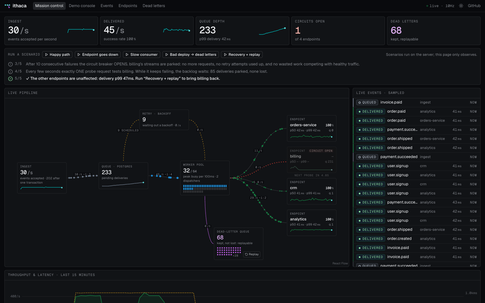

<div align="center">

# Ithaca

**A webhook delivery platform that never loses an event, and shows you every one.**

`Go 1.26` · `PostgreSQL 17` · `Kubernetes` · `KEDA` · `Kustomize` · `Docker` · `Caddy` · `Prometheus` · `Grafana` · `OpenTelemetry` · `React 19`



<sub>The live dashboard mid-incident. <code>billing</code> is down: its circuit is open and 231 deliveries are parked (not lost). 9 retries are backing off, 68 dead letters wait for replay, and the other endpoints are unaffected. Every particle is a real event.</sub>

</div>

---

## Contents

[What it is](#what-it-is) · [At a glance](#at-a-glance) · [How it works](#how-it-works) ·
[Design decisions](#design-decisions) · [Guarantees and how they're tested](#guarantees-and-how-theyre-tested) ·
[Evidence](#evidence) · [Security](#security) · [Observability](#observability) ·
[Limitations](#limitations-and-trade-offs) · [Run it](#run-it) · [Repository layout](#repository-layout) ·
[Further reading](#further-reading)

## What it is

Services like Stripe and GitHub tell your application that something happened (a payment
succeeded, a commit landed) by sending it HTTP requests called **webhooks**. Doing that reliably
is a distributed-systems problem: subscriber endpoints go down, slow down, rate-limit and return
errors, processes crash mid-request, and an event must never be lost or, when the subscriber
needs it, delivered out of order.

Ithaca is that delivery system, end to end:

- **Accepts** events over HTTP and commits them to Postgres before acknowledging (`202` in ~2 ms).
- **Delivers** each one to every matching subscription. Requests are HMAC-signed, retried with
  jittered backoff, and optionally ordered per key. The engine honors `Retry-After`, and a
  circuit breaker stops hammering endpoints that are down.
- **Never loses anything.** What can't be delivered goes to a dead-letter queue with its reason,
  and can be replayed into its original position in an ordered stream.
- **Shows it all live.** A real-time dashboard draws every event moving through the pipeline,
  with five narrated scenarios one click away: an endpoint going down, a slow consumer, a bad
  deploy, recovery and replay.

It is built to be inspected. Every design claim below has a test or a measurement behind it,
and the bugs those measurements found are written up rather than hidden.

## At a glance

Measured on one laptop (Apple M4) against a durable Postgres (fsync on). Method and raw tables:
[`bench/RESULTS.md`](bench/RESULTS.md).

| | |
|---|---|
| Ingest | **3,000 events/s** sustained, 100% accepted; p99 < 50 ms up to ~1,000/s |
| Delivery throughput | **13,560 deliveries/s** to a single endpoint (64 workers, 20 ms subscriber) |
| End-to-end latency at 200 events/s | **p50 38 ms · p99 54 ms**, of which 21 ms is the subscriber itself |
| A 30%-failing neighbor | healthy endpoint's p99 **53.8 → 53.4 ms**: unaffected |
| An endpoint down for 60 s | ingest **100% accepted**; 14.5k deliveries parked, **0 lost** |
| `kill -9` a dispatcher every 20 s | **0 lost, 0 phantom acks**, 0.01% duplicates (all carrying the same `Ithaca-Id`) |
| Rolling restart of all six services under load (k8s) | **9,001 / 9,001** accepted and delivered |
| KEDA autoscaling under a 60k-event burst | 2 → 10 dispatchers in 37 s; drained **2.7× faster** than fixed capacity |

## How it works

### Architecture

One Go module, one container image, a subcommand per service
([ADR-0001](docs/DECISIONS/adr-0001-single-binary-subcommands.md)):

```
   POST /v1/events
         │
   ┌─────▼──────┐   one transaction: idempotency claim, event row,
   │   ingest   │   fan-out, gapless per-stream sequence number      202 in ~2 ms,
   └─────┬──────┘                                                    no outbound calls
         │
   ┌─────▼──────────────────────────┐
   │ PostgreSQL                     │  the system of record AND the scheduler:
   │ events · streams · deliveries  │  retry times, breaker state and leases are rows
   └─────┬──────────────────────▲───┘
         │ lease STREAMS        │ fenced ack: attempt log + move to history
         │ (SKIP LOCKED)        │ + reschedule, one transaction
   ┌─────▼──────────────────────┴───┐        signed HTTPS          ┌─────────────┐
   │ dispatcher × N                 ├─────────────────────────────▶│ subscriber  │
   │ bounded pool · backpressure    │◀── 2xx / 4xx / 5xx / 429 ────┤  endpoints  │
   │ retry · breaker · DLQ          │                              └─────────────┘
   └─────┬──────────────────────────┘
         │ pre-aggregated frames (100 ms)
   ┌─────▼──┐   ┌────────┐   10 Hz frames + lossless deltas   ┌─────────────────┐
   │ Redis  ├──▶│   ws   ├───────────────────────────────────▶│ dashboard (SPA) │
   └────────┘   └────────┘                                    └─────────────────┘
```

| Service | Responsibility | Scales on |
|---|---|---|
| `ingest` | Accept and durably record events. Makes no outbound calls, so its availability never depends on a subscriber's health. | request rate |
| `dispatcher` | Lease streams, deliver, retry, open and close circuits, ack. Runs the lease reaper. | **worker demand, via KEDA** |
| `api` | Control plane (endpoints, subscriptions, DLQ) and the embedded dashboard. | CPU |
| `ws` | WebSocket hub for the live feed. Stateful, so it deploys separately from the API. | connections |
| `worker` | The demo engine (leader-elected), idempotency-key janitor, DLQ replay ramp. | fixed |
| `receiver-sim` | A programmable subscriber (latency, error rates, outages, hangs) for tests and the demo. | – |

### The life of one event

1. **Ingest** ([`internal/ingest`](internal/ingest/ingest.go)). In one transaction: claim the
   `Idempotency-Key` (a replay returns the original response, the same key with a different body
   is a `422`), insert the event, and fan out one delivery per matching subscription. Each
   delivery joins a **stream**, keyed by `(subscription, ordering_key)` for ordered
   subscriptions or a hashed lane otherwise, and gets the next gapless sequence number from
   `INSERT … ON CONFLICT DO UPDATE SET next_seq = next_seq + 1`.
2. **Lease** ([`queue.sql: LeaseStreams`](internal/store/queries/queue.sql)). A dispatcher first
   acquires free worker slots, then leases at most that many runnable streams with
   `FOR UPDATE SKIP LOCKED`. Each lease carries a fresh `lock_token` (a fencing token), and a
   heartbeat renews it during long drains.
3. **Deliver** ([`internal/deliver`](internal/deliver)). A worker fetches a batch from its stream
   (strict head-first for ordered streams, up to `max_concurrency` in flight for unordered lanes)
   and POSTs each delivery through a client whose dialer refuses private, loopback, link-local
   and NAT64/6to4-embedded addresses at connect time. Each request is signed
   `HMAC-SHA256(secret, event_id . timestamp . raw_body)`.
4. **Classify** ([`classify.go`](internal/deliver/classify.go)). `2xx` is success. `5xx`,
   timeouts and resets are retryable. `429` defers the stream by `Retry-After` without consuming an
   attempt. Other `4xx` and `3xx` are permanent. `410 Gone` also disables the endpoint.
5. **Ack** ([`queue.sql: CompleteDeliveries`](internal/store/queries/queue.sql)). One transaction,
   fenced by `lock_token`: record the attempts, move terminal deliveries to history (so the hot
   table holds only pending work), reschedule retries with full-jitter backoff
   ([`internal/retry`](internal/retry)), and update the circuit breaker
   ([`internal/breaker`](internal/breaker)). A worker that lost its lease can't write anything.
6. **Release.** The stream goes back with its next visibility computed from what is still
   pending: `ready` at the earliest due time, `circuit_open` (parked) while the breaker is open,
   `paused` if an ordered head died, or `idle` if it's empty.
7. **Dead letters** ([`internal/dlq`](internal/dlq)). A delivery that exhausts its attempts, or fails
   permanently, lands in the DLQ with the reason. Replay creates a new delivery for the same
   event, claimed once (so a double-click is safe). A dead *ordered* head is replayed into its
   original sequence number, which resumes the stream in exact order.
8. **Live view** ([`internal/live`](internal/live)). Dispatchers pre-aggregate every 100 ms into Redis
   pub/sub. The `ws` hub sends each dashboard 10 Hz frames, which are lossy (the newest
   supersedes an unsent one), plus lossless deltas reconciled from Postgres. A slow browser can
   never slow the pipeline down.

## Design decisions

The ones that shape everything else. Longer versions are in [`docs/DECISIONS/`](docs/DECISIONS/)
and [`docs/design/delivery-engine.md`](docs/design/delivery-engine.md).

**Lease streams, not messages.** A stream is held by at most one worker at a time, so per-key
ordering falls out of the lease rather than out of the query. `SKIP LOCKED` with `ORDER BY seq`
*looks* ordered and isn't, because skipping a locked row is exactly what reorders it.
Unordered subscriptions run the same code path over synthetic lane keys: one dequeue path, one
ack path ([ADR-0003](docs/DECISIONS/adr-0003-stream-leasing.md)).

**Acquire capacity before dequeuing.** The dispatcher takes worker slots first and leases exactly
that many streams. Dequeuing first and then looking for somewhere to put the work turns a
queue-depth problem into a memory problem, and takes out leases that expire unserviced.

**The queue table holds only pending work.** Terminal deliveries move to history in the same
statement that terminates them, so the hot table stays proportional to the backlog, not to
lifetime volume.

**Rate limits and open circuits are scheduling, not failure.** A throttled or broken endpoint
re-dates or parks its streams and frees the worker slot at once: no HTTP request, no consumed
attempt, no wasted lease.

**Postgres is the queue; Redis is optional.** The queue, retry schedule and breaker state live in
Postgres, and a breaker transition commits in the same transaction as the ack that caused it, so
the two can never disagree. Redis only carries the dashboard feed. The first full benchmark run
happened with Redis down by accident, and delivery never noticed.

**Autoscale on worker demand, not CPU or queue depth.** Dispatchers wait on network I/O, so CPU
misreads them as idle. Raw depth misleads twice: it counts work parked behind an open circuit,
and it counts 100k events on one ordered key, which only one worker can deliver. KEDA instead
reads `leased + due streams ÷ workers per pod` straight from Postgres. The first version scaled
on backlog and oscillated under sustained load
([ADR-0006](docs/DECISIONS/adr-0006-keda-on-parallelizable-work.md)).

## Guarantees and how they're tested

Ithaca is **at-least-once**, and says so. Exactly-once over HTTP would need a distributed
transaction with the subscriber, which doesn't exist. Instead, every delivery carries a
stable `Ithaca-Id` (constant across retries, crashes and replays), and
[`docs/at-least-once.md`](docs/at-least-once.md) lists all six places a duplicate can come from.

| Guarantee | Enforced by |
|---|---|
| **No loss.** After quiescence, events × subscriptions = delivered + dead-lettered. | `TestBurstOf10kEventsFullyDelivers`, `TestKilledDispatcherLosesNothing`, bench E8 (conservation checked against the receiver's own log) |
| **No phantom acks.** Nothing is marked delivered without a 2xx. | bench E8, `TestZombieWorkerIsFencedOut` |
| **No reordering** within an ordering key. | `TestOrderedStreamNeverReorders` (32 workers, 30% failures, race detector), `TestDeadOrderedHeadPausesStreamAndReplayRestoresOrder` |
| **No stranded work.** A stream with pending deliveries is always leasable. | `TestEnqueueRacingTheFinalReleaseIsNotLost` (forces the interleaving that caused a real bug) |
| **Ingest never blocks** on subscriber health. | bench E5: 100% accepted through a 60 s outage |
| **Retries are scheduling.** `429` consumes no attempt; an open circuit sends no requests. | `TestRateLimitingDoesNotConsumeAttempts`, `TestBreakerParksStreamsProbesOnceAndRecovers`, `TestOpenCircuitIsHonoredAtLeaseTime` |
| **Replay is idempotent.** | `TestReplayIsIdempotentUnderConcurrentDoubleClick` |

**Test strategy.** 173 test functions in four layers:

- **Unit.** Pure state machines: the retry ladder, breaker transitions, classification and
  signing. Time-dependent code (the worker pool, leases, backoff) runs under Go's `synctest`
  with a fake clock.
- **Integration (`-tags integration`).** Against real Postgres, never mocks, because `SKIP LOCKED`,
  `ON CONFLICT` row locks and unique-index waits *are* Postgres behavior. Each test gets its own
  database copied from a migrated template in ~20 ms ([`internal/testdb`](internal/testdb)).
- **Chaos and benchmarks.** `kill -9` under load, outages, failing neighbors, all with exact
  percentiles computed in SQL from the attempt log ([`bench/`](bench/)).
- **On a real cluster (CI).** Every change deploys to a throwaway k3d cluster. It then proves the
  NetworkPolicies are *enforced* (11 allow/deny probes), restarts every deployment under load
  (0 lost, 0 rejected), and runs a burst that must make KEDA scale out and back in
  ([`e2e-k3d.yml`](.github/workflows/e2e-k3d.yml)).

## Evidence

**Benchmarks** ([`bench/RESULTS.md`](bench/RESULTS.md)). E1 measures the ingest ceiling, E2 drain
rate against worker count, and E3 latency split into queue wait and delivery time. E4 adds a
failing neighbor, E5 a 60 s outage with recovery, and E8 `kill -9` chaos with a conservation
check. Every number in [At a glance](#at-a-glance) comes from these runs.

**What the measurements caught.** Bugs and design flaws that functional tests had missed. Each is
fixed, pinned by a test where it can be, and written up in
[`docs/ARCHITECTURE.md`](docs/ARCHITECTURE.md#measured-not-assumed):

- **A connection pool narrower than the concurrency.** The delivery client kept 16 idle
  connections per host while sending up to 512 requests to that host at once. A sustained
  drain opened a new connection for almost every delivery, piled up 16k sockets in TIME_WAIT
  and ran out of ephemeral ports within two seconds, falling from 14k to 2k deliveries/s. The
  fix tripled throughput. `TestConcurrentDeliveriesToOneHostReuseConnections` counts the
  connections dialed.
- **A lost wakeup under READ COMMITTED.** An event enqueued just as its stream was released
  could leave the stream `idle` with a delivery in it, forever (about 1 in 45,000). The release
  blocked on the enqueue's row lock; Postgres re-checked the stream row at its latest version,
  but the "anything pending?" subquery kept its stale snapshot.
- **An autoscaler that oscillated.** Scaling on backlog took the dispatchers from 9 to 3 *during*
  a burst, as soon as they caught up. It now scales on work waiting or in flight.
- **Ack batching set the duplicate rate.** Acking once per 64-message batch meant 17% duplicates
  after a crash. Acking in chunks of the endpoint's concurrency brought it to ~5%, and 0.01% in E8.

**Kubernetes** ([`deploy/k8s/README.md`](deploy/k8s/README.md)). The manifests are deployed by
image digest under the `restricted` Pod Security Standard, with default-deny NetworkPolicies. The
dispatcher's egress excludes every private range, so SSRF is blocked at the network layer too.
Probes are split so liveness never touches a dependency, and the grace period exceeds the
in-process drain. The autoscaling results, with their baseline:

| 60k-event burst, slow ordered consumer | pinned at 2 dispatchers | KEDA, 2 → 10 |
|---|---:|---:|
| peak backlog | 89,965 | **5,510** |
| fully drained | 411 s | **152 s** (2 s after the burst ended) |

## Security

- **API keys.** The format is `ith_<prefix>_<secret>`, with 256 bits of randomness. Only a SHA-256
  hash is stored. Lookup goes by the public prefix and the comparison is constant-time.
- **Signed deliveries.** `Ithaca-Signature: v1,k=<key_id>,<hmac>` covers the event id and
  timestamp as well as the raw body, so a captured request can't be replayed forever. The
  header format already supports several signatures at once, for zero-downtime secret rotation.
- **SSRF.** Every connection is vetted at dial time (after DNS), refusing private, loopback,
  link-local, CGNAT and NAT64/6to4-embedded addresses. No redirect is followed, because a
  redirect is classified as a permanent failure. On Kubernetes, the dispatcher's NetworkPolicy
  enforces the same rule a second time.
- **Endpoint verification.** An endpoint receives nothing until it echoes a signed
  `Ithaca-Challenge`, so the service can't be turned into a request amplifier against
  arbitrary URLs.
- **Public demo mode.** Endpoints are restricted to the built-in sinks, and demo controls are
  rate-limited per client IP, which the proxy sets and the client can't forge.
- **Runtime.** A distroless image (no shell, no package manager) running as non-root. On
  Kubernetes, add a read-only root filesystem, all capabilities dropped, seccomp, and no
  service-account token, enforced by the namespace's `restricted` Pod Security level.

## Observability

- **Metrics.** Prometheus on each service's admin port: ingest, queue depth, oldest pending,
  queue wait split from delivery time, pool occupancy (peak per window), leases, acks, breaker
  transitions and the DLQ.
- **Dashboards as code.** [`dashboards.py`](deploy/compose/grafana/dashboards.py) generates a
  27-panel Grafana dashboard. Compose and the Kubernetes Grafana load the same file.
- **Alerts.** Ten rules about user-visible failure: delivery lag, a stalled queue, ingest
  errors, dispatchers down, pool saturation, dead letters rising. They are validated with
  promtool, and generated into a `PrometheusRule` for Kubernetes.
- **Tracing.** OpenTelemetry across the queue hop with **span links**: a delivery's span links
  to the ingest span that created it, instead of pretending a retry hours later is its child.
- **Health.** `/healthz` (process only), `/readyz` (dependencies) and `/startupz` on a separate
  admin listener that is never exposed publicly.

## Limitations and trade-offs

Known costs, stated plainly:

- **At-least-once, not exactly-once.** Subscribers must dedupe on `Ithaca-Id`, as with any
  webhook provider.
- **Ordering has a throughput cost.** The gapless sequence lock is held through commit, which
  sets the ingest ceiling on hot streams (E1). It applies per stream, not globally, so more keys
  or more lanes spread it.
- **Queue wait has a polling floor.** With no wake signal from ingest to the dispatchers
  (keeping Redis off the critical path), a new event waits for the next poll: 17 ms p50 at
  load, more when idle.
- **A saturated pool lets a slow consumer starve its neighbors.** `max_concurrency` caps
  requests per stream, but not how many workers one endpoint's streams can hold. Spare capacity
  or autoscaling hides this. Fair leasing would fix it, and isn't built yet.
- **One Postgres is the scaling ceiling.** On the laptop cluster, ~10 dispatchers saturate it.
  Beyond that, the next steps are partitioned history and a managed database.

## Run it

**The production stack, locally.** Postgres, Redis, every service and Caddy with TLS. Needs
only Docker:

```bash
make prod-local        # → https://localhost, then press a scenario button
make prod-local-down
```

The same files deploy to any small VM ([runbook](deploy/prod/README.md)). A `v*` tag builds a
multi-arch image, pushes it to GHCR and, if a server is configured, rolls it
([`deploy.yml`](.github/workflows/deploy.yml)).

**On Kubernetes.** Needs Docker, `k3d`, `kubectl`, `helm` and `kustomize`:

```bash
make k8s-up            # 3-node k3d cluster + registry + KEDA
make k8s-deploy        # build, push, deploy by digest → http://ithaca.localhost:8088
make k8s-check         # NetworkPolicies enforced; restart everything under load
make k8s-burst         # watch KEDA scale the dispatchers 2 → 10 → 2
make k8s-monitoring    # optional: Prometheus + Grafana at http://grafana.localhost:8088
make k8s-down
```

**For development.** Services run on the host for two-second rebuilds, with dependencies in
compose:

```bash
make up                # Postgres, Redis, Prometheus, Grafana, Jaeger
make migrate && make tenant NAME=acme   # prints an API key, shown once
make dev               # all six services + the dashboard (Vite) in the background
make demo              # or: seed the demo tenant and run everything in demo mode

curl -i localhost:8081/v1/events \
  -H "Authorization: Bearer $ITHACA_API_KEY" -H "Content-Type: application/json" \
  -H "Idempotency-Key: order-42-created" \
  -d '{"type":"order.created","ordering_key":"order_42","payload":{"total":99.5}}'
```

| | |
|---|---|
| Dashboard | <http://localhost:5173> |
| API · ingest · ws · receiver-sim | :8080 · :8081 · :8082 · :8090 |
| Health and metrics (per service) | `:9080`–`:9085` → `/readyz`, `/metrics` |
| Grafana · Prometheus · Jaeger | :3000 · :9090 · :16686 |

`make check` runs what CI runs (fmt, vet, lint, unit tests). `make test-integration` runs the
Postgres suite. `make bench E=e3` reruns one benchmark. `make help` lists the rest.

## Repository layout

```
cmd/ithaca/        one entrypoint, a subcommand per service (+ migrate, tenant, demo, probe)
internal/
  ingest/          POST /v1/events: idempotency, fan-out, gapless per-stream sequence
  queue/pg/        the queue driver: lease, fetch, fenced ack, release, reap
  store/           pgx pool; SQL in store/queries, sqlc-generated code in store/gen
  worker/          the bounded pool: slots, dispatch loop, heartbeat, drain, executor
  deliver/         HTTP client, HMAC signing, SSRF-guarded dialer, response classification
  retry/ breaker/  pure functions: full-jitter backoff, circuit-breaker state machine
  dlq/ verify/     dead-letter replay; the endpoint verification handshake
  live/            dashboard feed: aggregating publisher, Redis bus, WebSocket hub
  api/ auth/       control plane; API-key authentication
  demo/ receiver/  the narrated demo engine; the programmable subscriber
  platform/        config, logging, health, graceful shutdown, metrics, tracing, HTTP
  testdb/          per-test Postgres databases from a migrated template
web/               dashboard source (Vite, React 19, TanStack Query, uPlot, React Flow + canvas)
migrations/        goose, forward-only
bench/             k6 load scripts, the experiment harness, RESULTS.md
deploy/compose/    development dependencies, Prometheus rules, Grafana dashboards as code
deploy/prod/       the single-VM production stack: compose + Caddy, and its runbook
deploy/k8s/        Kustomize base, components (deps, autoscaling) and overlays; k3d; monitoring
scripts/           dev process manager; k8s deploy, policy, rollout and burst checks
docs/              architecture, guarantees, ordering, design docs, ADRs
```

## Further reading

| Document | What's in it |
|---|---|
| [`docs/ARCHITECTURE.md`](docs/ARCHITECTURE.md) | The system in depth, and what measurement changed in the design |
| [`docs/at-least-once.md`](docs/at-least-once.md) | The six sources of duplicates, and how a subscriber dedupes |
| [`docs/ordering.md`](docs/ordering.md) | How per-key order is kept, and what it costs |
| [`docs/design/delivery-engine.md`](docs/design/delivery-engine.md) | The original delivery-engine design |
| [`docs/design/dashboard.md`](docs/design/dashboard.md) | The dashboard's design: stack choice, the design system (color as data), the live flow canvas |
| [`docs/DECISIONS/`](docs/DECISIONS/) | ADRs: single binary, embedded SPA, stream leasing, k3d, Kustomize, KEDA |
| [`bench/RESULTS.md`](bench/RESULTS.md) | Every benchmark: configuration, percentiles, findings |
| [`deploy/k8s/README.md`](deploy/k8s/README.md) | The Kubernetes decisions, verification and autoscaling results |
| [`deploy/prod/README.md`](deploy/prod/README.md) | Deploying the single-VM stack |

## License

MIT
